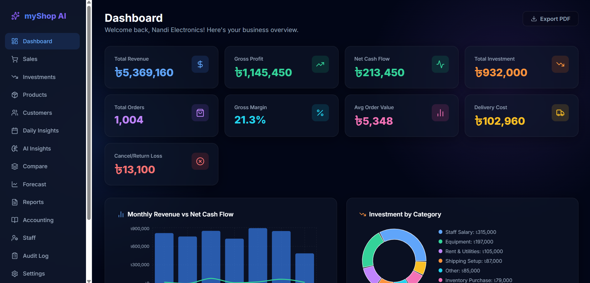

# myShop AI
> **AI Inventory & Sales Prediction System** — Smart web-based platform for inventory management, sales tracking, and AI-driven decision-making.
>
> **Official Team:** CSE4204-8C-T08 | **Section:** 8C | **Team Leader:** Sheikh Rafiqul Islam Rafi



## 1. Project Description
The AI Inventory & Sales Prediction System is an intelligent, cloud-based business management platform engineered to modernize traditional warehouse keeping and transactional logging. By integrating decoupled full-stack web architectures with machine learning models and dynamic APIs, the system provides a unified operational surface to monitor real-time stock availability, record daily revenue streams, map micro-trends, and generate interactive next-month sales projection curves.

The platform helps businesses:
- ✅ Reduce Overstocking & Stock Shortages
- 📈 Analyze Product Performance
- 💹 Monitor Revenue & Sales Trends
- 💡 Generate Intelligent Business Insights
- 🗓️ Improve Business Planning & Decision-Making

**Team Information**
| Field | Details |
|---|---|
| Official Team Name | CSE4204-8C-T08 |
| Section | 8C |
| Team Leader | Sheikh Rafiqul Islam Rafi |
| Team Members | Rafi (11220320922), Antar Sadhu (11220320940), Md. Shajjad Mahmud (11220320928), Arjun Mirbor (11220320971) |

## 2. Problem Statement
Small and medium business owners in emerging markets often rely on scattered spreadsheets or pen-and-paper to manage daily sales. This manual process makes it difficult to track profitability, identify at-risk customers, or gain actionable business insights without hiring technical experts. 

## 3. Importance of the Problem
Without proper analytics, businesses lose money due to hidden inefficiencies. They fail to identify which products are actually driving profit, when customers stop buying, or if their daily margins are shrinking. A solution to this problem democratizes data intelligence, empowering millions of small business owners to grow sustainably.

## 4. Project Objectives
To meet academic and industry standard requirements, the platform guarantees the following system milestones:

- **Unified Inventory Management**: Structured, secure interface to track granular product details, categories, costs, and localized stock status.
- **Real-Time Sales Ledger**: Automated transaction workflows that instantly adjust downstream asset volumes upon item checkout.
- **AI-Driven Forecasting**: Predictive analytics evaluating historical sales logs to project next-month forward demand curves.
- **Proactive Automated Alerting**: Warning hooks triggering visual indicators when stock counts fall below custom low-stock thresholds.
- **Cloud-Scale Infrastructure**: High-availability server layout sustaining concurrent queries without exponential interface latency.

## 5. System Architecture
The project is divided into two main parts: a **Frontend** (React) and a **Backend** (Node.js / Express).

### Folder Architecture
- **Sales Dashboard**: See your Revenue, Profit, Total Orders, and Profit Margin at a glance.
- **Manage Orders**: Add, edit, delete, and search sales orders just like you would in Excel.
- **Role-Based Access**: Create accounts for Owners, Admins, and Staff with different permissions.
- **AI Business Insights**: Generate on-demand, bilingual (Bengali & English) executive summaries analyzing sales trends, at-risk customers, and overarching business health, powered entirely by Gemma 4.
- **Automated Daily Emails**: Every day at your configured time, the system automatically sends a summary email with AI insights.
- **Dynamic Pricing AI**: Intelligent pricing recommendations powered by Gemma 4, analyzing sales velocity and stock buffers to maximize margin and clear dead stock.
- **AI Restock Planner**: A hybrid approach using deterministic Python math to calculate exact purchase quantities and stockout dates, combined with Gemma 4 to generate a strategic, bilingual executive summary of the weekly purchase plan.
- **Google Sheets Sync**: (Optional) Connect a Google Sheet to push or pull orders directly to the web app, plus many more hidden features to streamline your business!

### 🌟 Feature Gallery

**Secure Authentication & Onboarding**


**AI Business Insights & Daily Reports**


**Dynamic Pricing AI**


**AI Restock Planner**


**Comprehensive Financials**


## 4. Proposed Solution
**myShop AI** bridges this gap by transforming a standard spreadsheet workflow into an enterprise-level AI analytics platform. It provides an intuitive, easy-to-use dashboard that automates reporting and gives actionable advice.

**Key Features:**
- **Sales Dashboard**: See your Revenue, Profit, Total Orders, and Profit Margin at a glance.
- **Manage Orders**: Add, edit, delete, and search sales orders just like you would in Excel.
- **Role-Based Access**: Create accounts for Owners, Admins, and Staff with different permissions.
- **AI Business Insights**: Generate on-demand, bilingual (Bengali & English) executive summaries analyzing sales trends, at-risk customers, and overarching business health, powered entirely by Gemma 4.
- **Automated Daily Emails**: Every day at your configured time, the system automatically sends a summary email with AI insights.
- **Dynamic Pricing AI**: Intelligent pricing recommendations powered by Gemma 4, analyzing sales velocity and stock buffers to maximize margin and clear dead stock.
- **AI Restock Planner**: A hybrid approach using deterministic Python math to calculate exact purchase quantities and stockout dates, combined with Gemma 4 to generate a strategic, bilingual executive summary of the weekly purchase plan.
- **Google Sheets Sync**: (Optional) Connect a Google Sheet to push or pull orders directly to the web app, plus many more hidden features to streamline your business!

## 7. Gemma 4 Integration
This project uses the official Google AI APIs (via the `google-genai` SDK) to communicate exclusively with **Gemma 4**.

- **How it works**: The backend securely holds the `GOOGLE_AI_STUDIO_KEY`. When generating a report, checking pricing, or planning restocks, the backend summarizes structured sales data (Revenue, Orders, Velocity, Days-of-Stock-Left) and prompts Gemma 4 to analyze the business's health.
- **Primary AI Features**: Gemma 4 is the sole intelligence engine behind the "Insights" page, the **Dynamic Pricing Optimizer**, and the **AI Restock Planner**.

## 5. System Architecture
The project is divided into two main parts: a **Frontend** (React) and a **Backend** (Node.js / Express).

### Folder Architecture
```text
myShop-AI/
├── ai_service/              # Gemma 4 / Google AI integration (ai_service.js, prompts.js)
├── backend/                 # Node.js / Express Backend
│   ├── src/                 # Backend source (routes, controllers, models)
│   ├── app.js               # Main application entry point
│   ├── server.js            # Server starter
│   ├── package.json         # Backend dependencies
│   └── .env                 # Environment config
├── frontend/                # React Frontend (Vite)
│   ├── src/                 # React source (components, pages, contexts, services)
│   ├── package.json         # Node dependencies
│   ├── index.html           # Entry HTML
│   └── vite.config.js / etc # Vite config
├── database/                # Database files / migrations
├── demo_data/               # Sample CSV data for bulk upload
├── Screenshots/             # Project screenshots
└── README.md                # Project documentation
```

## 6. Technical Implementation
- **Frontend**: Built with React and Vite for fast performance. Uses `Recharts` for displaying beautiful Revenue and Profit charts, and natively renders rich Markdown (bolding, etc.) for all Gemma 4 summaries.
- **Backend**: Built with Node.js / Express (`backend/app.js`, `backend/src/`).
- **Database**: Uses a database configured via `database/` folder (check backend `.env` for connection details).
- **AI Integration**: `ai_service/` handles Gemma 4 prompts and Google AI Studio API calls (`google-genai`).
- **Authentication**: Uses JWT managed in backend source.
- **Background Tasks**: Scheduled tasks can be handled via backend services or external cron (check `backend/src/` for email/report scheduling).
- **AI-Assisted Development**: See [How Codex & GPT-5.6 were used](How_Codex_&_GPT-5.6_were_used.md) for details on the implementation process.

## 7. Challenges Encountered
- **Prompt Engineering for Bengali**: Ensuring Gemma 4 generated high-quality, professional business advice in Bengali required careful prompt tuning, as direct translations often sounded unnatural.
- **Data Formatting for AI**: Feeding raw tabular data into the LLM resulted in hallucinations. We overcame this by pre-calculating KPIs (Revenue, AOV, Profit) in Python and passing a structured summary to the model. We also ensured accuracy by strictly handling cancelled and returned orders in the Python layer before sending net figures to Gemma.

## 8. Expected Impact
By making AI-driven analytics accessible and affordable, myShop AI can help thousands of small shop owners optimize their inventory, retain customers, and increase their daily profit margins. 

## 9. Future Improvements
- **Voice-First Order Entry**: Let shop owners speak an order in Bengali and have Gemma 4 extract a structured sale, so even non-typists can log sales at the counter.
- **Two-Way Google Sheets Sync**: Implement real-time, bidirectional synchronization between the web app and Google Sheets.
- **Mobile Application**: Build a dedicated mobile app for store staff to input sales directly from their phones.

## 9. Technology Stack

**Frontend**
- React + TailwindCSS

**Backend**
- Node.js + Express.js

**Database**
- PostgreSQL / MongoDB (configured via `database/` and `backend/.env`)

**AI Integration**
- Google Gemini (via `google-genai` SDK in `ai_service/`)

**Deployment**
- Vercel — Frontend Hosting & Global Edge Distribution
- Render / Railway — Decoupled API Server Lifecycle Management
- MongoDB Atlas / Supabase — High-Availability Cloud Database & Replication Clusters

---

## 💻 Repository Requirements

### 1. Dependencies
- **Backend**: Node.js 18+. All dependencies listed in `backend/package.json`.
- **Frontend**: Node.js 20+. All dependencies listed in `frontend/package.json`.
- **AI Key**: `GOOGLE_AI_STUDIO_KEY` required in `backend/.env` (see `backend/.env.example`).

### 2. Configuration Files
The project relies on environment variables. Copy `backend/.env.example` to `backend/.env` and fill in your keys:
```env
# Required for Gemma 4 AI features
GOOGLE_AI_STUDIO_KEY="AIzaSy..."
```

### 3. Installation Instructions

**Step A: Clone the Repository**
First, download the code and navigate into the newly created project folder:
```powershell
git clone https://github.com/sheikhrafiqulislamrafi/CSE4204-8C-t08-ai-inventory-and-sales-prediction-system.git
cd CSE4204-8C-t08-ai-inventory-and-sales-prediction-system
```

**Step B: Backend Setup**
Open a terminal in the main project folder and run:
```powershell
cd backend
npm install
node server.js
# or: node app.js
```

**Step C: Frontend Setup**
Open a new terminal in the main project folder and run:
```powershell
cd frontend
npm install
npm run dev
```

### 4. Usage Guide
1. **Getting Started**: Open `http://localhost:5173` in your browser and click **Register** to create your Owner account.
2. **Hydrate with Data**: Instantly populate your database to test the AI features by uploading the 3 sample CSV files provided in the `demo_data/` folder:
   - **Products**: Navigate to the **Products** page, click the **Bulk Upload** tab, and upload `demo_data/products.csv`.
   - **Investments**: Navigate to the **Investments** page, click the **Bulk Upload** tab, and upload `demo_data/investments.csv`.
   - **Sales**: Navigate to the **Sales** page, click the **Bulk Upload** tab, and upload `demo_data/sales.csv`. (The AI will instantly analyze your imported sales data!)
3. **Explore the Dashboard**: Head to the **Dashboard** to watch your Revenue and Profit charts update in real-time based on your sales.
4. **Generate AI Insights**: Go to the **Insights** page and click "Generate Full Report" to receive a comprehensive, bilingual analysis of your business health from Gemma 4.
5. **Optimize with Dynamic Pricing**: On the **Products** page, hit the **"Pricing AI"** button. Gemma 4 will analyze your sales velocity and stock buffers to suggest markup opportunities or clearance discounts.
6. **Plan AI Restocks**: Also on the **Products** page, click **"Restock AI"**. Gemma 4 cross-references your 30-day sales velocity and current inventory to generate a precise 14-day purchase plan (what to buy, what to skip).
7. **Automate Daily Reports**: Finally, go to **Settings** and schedule an automated daily AI email so you wake up to fresh insights every morning!

### 5. Troubleshooting
If you encounter errors setting up the project locally, try these common fixes:

- **`express` / `node` not recognized**: Ensure Node.js 18+ is installed (`node -v`). Then run `npm install` inside `backend/` and `frontend/`.
- **Backend won't start**: Check `backend/.env` exists and contains `GOOGLE_AI_STUDIO_KEY`. Verify `backend/app.js` / `server.js` runs (`node server.js`).
- **Frontend can't connect**: Make sure the backend server is running and `frontend/package.json` dependencies installed (`npm install`). Check `frontend/src/services/` for the correct backend URL/port.
- **AI Insights return errors**: Confirm the `GOOGLE_AI_STUDIO_KEY` is valid and has quota. Check `ai_service/ai_service.js` for API errors.
- **Database issues**: Verify `database/` folder has proper connection/config and backend `.env` points correctly.

For more help, see the project documentation or check `backend/src/` and `frontend/src/` for setup comments.
